<div align="center">

<a href="https://github.com/infinityprogrammer">
  
</a>

<a href="https://github.com/infinityprogrammer">
  
</a>

<br/>

<a href="https://www.linkedin.com/in/muhammed-rafi-kkl/"></a>
<a href="https://skills.sh/infinityprogrammer/skills"></a>


</div>

<br/>


## ∞ &nbsp;About Me

```python
import frappe

rafi = frappe.get_doc({
    "doctype": "Developer",
    "full_name": "Muhammed RAFI",
    "location": "Dubai, UAE 🇦🇪",
    "role": "Software Engineer · Frappe & ERPNext",
    "languages": ["Python", "JavaScript", "Dart", "PHP", "SQL"],
    "frameworks": ["Frappe", "ERPNext", "Vue 3", "Flutter"],
    "focus": ["ERP systems", "Custom Frappe apps", "AI agents"],
    "motto": "If it can be a DocType, it can be automated.",
})

rafi.insert()
rafi.submit()  # docstatus = 1 ✅ shipped
```

<table>
<tr>
<td width="50%" valign="top">

#### 🏗️ &nbsp;What I build
- **Custom Frappe & ERPNext apps**: HR, finance, support and recruitment
- **ERP reporting**: group ledgers, trial balances and multi-company accounting
- **Modern front ends** with Vue 3, `frappe-ui` and Tailwind
- **Mobile apps** with Flutter & Dart

</td>
<td width="50%" valign="top">

#### ⚡ &nbsp;Right now
- 🔭 Shipping **HireLens**, a recruitment platform on Frappe v16
- 🤖 Building **AI agents** and publishing **agent skills**
- 🌱 Exploring LLM tooling that plugs into ERP data
- 💬 Ask me about **Frappe, ERPNext and Python**

</td>
</tr>
</table>


## 🛠️ &nbsp;Tech Stack

<div align="center">

**ERP Core**


<br/>

**Languages & Frameworks**


<br/>

**Data, DevOps & Tools**


<br/>

**AI**


</div>


## 🚀 &nbsp;Featured Projects

<div align="center">

<a href="https://github.com/infinityprogrammer/hirelens"></a>
<a href="https://github.com/infinityprogrammer/skills"></a>
<a href="https://github.com/infinityprogrammer/hris"></a>
<a href="https://github.com/infinityprogrammer/tesla"></a>

</div>


## 📊 &nbsp;GitHub Analytics

<div align="center">


</div>

## 🐍 &nbsp;Contribution Snake

<div align="center">
  <picture>
    <source media="(prefers-color-scheme: dark)" srcset="https://raw.githubusercontent.com/infinityprogrammer/infinityprogrammer/output/snake-dark.svg" />
    <source media="(prefers-color-scheme: light)" srcset="https://raw.githubusercontent.com/infinityprogrammer/infinityprogrammer/output/snake.svg" />
    
  </picture>
</div>

<br/>

<div align="center">

<em>“Every great system starts as a single DocType.” ∞</em>

<br/>

<a href="https://www.linkedin.com/in/muhammed-rafi-kkl/"></a>

</div>


